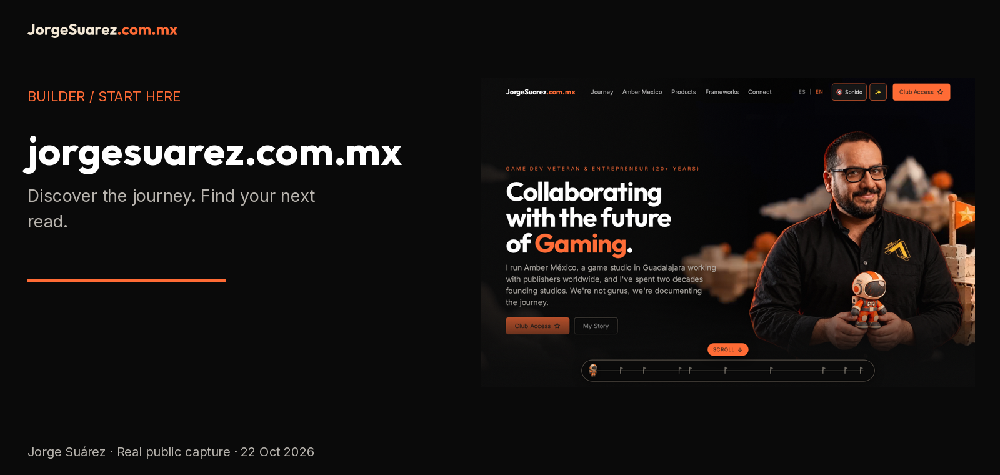

[Español](README.md) | [English](README.en.md)

<picture><source media="(max-width: 600px)" srcset="docs/media/cover-en-mobile.png"></picture>

# jorgesuarez.com.mx

**Discover the journey and find the project you care about.** [Open the site](https://jorgesuarez.com.mx/) and navigate to the story, projects or contact. No installation is needed.

## What is it?
Jorge Suárez's personal site: a presentation of his game industry journey, initiatives, resources and contact routes. It is a public entry point to content and links, not proof that every external service is available.

## Who is it for?
People interested in games, entrepreneurship and Jorge's public projects, as well as those looking for a contact route.

## Why does it exist?
To bring the story, projects and lessons together. Discover Jorge's work in games and follow the links to an initiative that interests you.

## How do I use it?
1. [Visit the page](https://jorgesuarez.com.mx/).
2. Use **ES / EN** to choose a language. Public capture navigation labels include Journey, Amber Mexico, Products, Frameworks and Connect; some labels may remain in English.
3. Open **Products** to explore projects or **Connect** to find contact. Check the destination's terms before sharing data or paying.

Amber and other companies retain their identity: the builder's personal brand does not replace their brandkits or imply authorship or ownership of their products.

## When should or shouldn't I use it?
Use it to discover the journey, explore links and decide what to read next. Do not treat it as a customer dashboard, a contract, a demonstrated learning platform or proof that every initiative is available.

## Where can I find it?
[Public site](https://jorgesuarez.com.mx/) · [Project profile](https://github.com/jorgefsb) · [Official brandkit](https://brandkit.jorgesuarez.com.mx/).

## Before continuing
- **Availability:** public page checked with HTTP 200 in Chromium on 22 October 2026. This does not prove which repository revision is deployed.
- **Requirements and technical help:** a modern browser and connection. Reading needs no developer; editing or publishing requires technical review. Universal mobile or GPU performance is not guaranteed.
- **Cost and licensing:** reading the page requires no payment; linked offers may have their own costs. `package.json` declares `UNLICENSED`; visible code does not grant reuse rights. Brand artwork and photos are not MIT.
- **Privacy:** reading connects to the site and its resources; external destinations have their own policies. Cookies, storage and all providers have not been audited. The evidence submits no forms or personal information.
- **Limitations:** public navigation and scrolling were checked, not club access, payments, forms or private systems. Captures document the observed site, not functionality added by this documentation.
- **Help:** [Jorge's public email](mailto:jorgefsb@gmail.com) or [repository issues](https://github.com/jorgefsb/jorgesuarez.com.mx/issues), without secrets or customer data.

## Real walkthrough

[Watch the real video](docs/media/walkthrough.mp4) · [English captions and transcript](docs/WALKTHROUGH.en.md) · [Subtítulos y transcripción ES](docs/WALKTHROUGH.md). Public-page recording, without submissions or account access.

## Separate technical path
[Repository maintenance notes](docs/TECHNICAL.en.md) · [Documentation guide](docs/REPOSITORY-DOCUMENTATION.en.md) · [Media notice](docs/ASSET-NOTICE.en.md).

The previous README attributes v2 to a private source repository and mentions GitHub Pages behind Cloudflare, while retaining older Vercel references. **The relationship between this checkout, the served build and the current provider has not been verified.** Do not treat those notes as deployment or rollback instructions. Historical records remain untouched.
