 

 

**[▶ Visitar el sitio](https://jorgesuarez.com.mx)** · Más proyectos en [github.com/jorgefsb](https://github.com/jorgefsb)

---

Recorrido real del sitio en vivo, grabado el 10 nov 2026 en Chromium (1280×720). Sin retoque. Se reproduce una sola vez; recarga la página para verlo de nuevo. <a href="docs/readme/tour.mp4">Ver el video MP4</a>

## ¿Qué es?

El sitio personal de Jorge Suárez. Reúne su trayectoria, su trabajo en Amber México, sus productos, sus frameworks, su laboratorio y cómo contactarlo. Está en español e inglés.

## ¿Para quién es?

Para quien quiere saber quién es Jorge, qué ha construido y cómo jugar o trabajar con él: gamers, gente que hace videojuegos, emprendedores, prensa y organizadores de eventos.

## ¿Qué dolor resuelve?

Más de 20 años de trabajo estaban repartidos entre redes, notas de prensa, canales y proyectos. Quien llegaba a un pedazo no veía el resto.

## La propuesta

Un solo lugar que cuenta la historia completa y manda a cada proyecto. Está hecho para sentirse como un juego: scroll narrativo, el menú «Juega» para elegir cuánto responde la página, y Moki escondido en los bordes.

## ¿Cómo se usa?

1. Entra a [jorgesuarez.com.mx](https://jorgesuarez.com.mx).
2. Cambia de idioma con ES / EN.
3. Con «Juega» subes o bajas la intensidad. Si tu sistema pide movimiento reducido, la página se queda quieta.

## ¿Cuándo conviene y cuándo no?

Conviene para conocer a Jorge, llegar a sus proyectos o escribirle.

No es el sitio de Amber ni de sus otras empresas: cada una tiene el suyo. Tampoco busques aquí el código fuente del sitio; este repo recibe el build ya armado.

## ¿Dónde lo pruebo?

En vivo: **[jorgesuarez.com.mx](https://jorgesuarez.com.mx)**

  
  

Capturas reales del sitio en vivo, 10 nov 2026: escritorio (1280×720) y móvil (390×780).

## Hasta dónde llegamos

La versión 2.0 está en producción desde el 12 de octubre de 2026 y se sirve con GitHub Pages detrás de Cloudflare.

El v1 quedó respaldado en el tag `v1-final-2026-10-12` y en la rama `v1-legacy`.

## Para quien construye

- El código fuente del v2 vive en un repo privado. Este repo recibe el build y lo publica.
- Rollback al v1: el deploy del v2 es un solo commit. `git revert` de ese commit y push a `main`.
- Candado de caché: si cambias un CSS o JS que carga `index.html`, súbele su `?v=` en `index.html`. El workflow `version-assets` lo revisa en cada pull request, pero solo para los archivos de `css/` y `js/`. Lo que `index.html` carga desde `engine/` hay que subirlo a mano: ahí no hay candado.
- Identidad y voz: [brand-guidelines.md](./brand-guidelines.md) y el [BrandKit](https://brandkit.jorgesuarez.com.mx).

## Licencia

El contenido del sitio, el retrato y la marca conservan todos los derechos: no tienen licencia abierta.

Los componentes que el sitio trae empaquetados sí conservan su licencia MIT, cada uno con su archivo: el motor de scroll de `engine/`, que es scroll-craft de Nate Herk ([`engine/LICENSE`](./engine/LICENSE)), y los efectos propios de `vfx/`: [`vfx/game-feel/1.0.1/LICENSE`](./vfx/game-feel/1.0.1/LICENSE), [`vfx/papacito-juice/1.0.1/LICENSE`](./vfx/papacito-juice/1.0.1/LICENSE) y [`vfx/cursor-liquido/1.0.1/LICENSE`](./vfx/cursor-liquido/1.0.1/LICENSE).

---

Hecho con amor ❤️🎮 por <a href="https://jorgesuarez.com.mx">JorgeSuarez.com.mx</a> · <a href="https://github.com/jorgefsb">Más proyectos</a> · <a href="./README.md">Read in English</a> Documentación actualizada el 10 nov 2026.

