 

 

**[▶ Visit the site](https://jorgesuarez.com.mx/?lang=en)** · More projects at [github.com/jorgefsb](https://github.com/jorgefsb)

---

Real walkthrough of the live site, recorded 10 Nov 2026 in Chromium (1280×720). No retouching. It plays once; reload the page to watch it again. <a href="docs/readme/tour.mp4">Watch the MP4 video</a>

## What is it?

The personal site of Jorge Suárez. It brings together his story, his work at Amber México, his products, his frameworks, his lab and how to reach him. It is available in Spanish and English.

## Who is it for?

For anyone who wants to know who Jorge is, what he has built and how to play or work with him: gamers, people who make games, entrepreneurs, press and event organizers.

## What pain does it solve?

More than 20 years of work were spread across social networks, press clips, channels and projects. People who found one piece did not see the rest.

## The proposal

One place that tells the whole story and sends you to each project. It is built to feel like a game: narrative scroll, the «Juega» menu to choose how much the page responds, and Moki hiding at the edges.

## How do I use it?

1. Go to [jorgesuarez.com.mx](https://jorgesuarez.com.mx/?lang=en).
2. Switch language with ES / EN.
3. Use «Juega» to turn the intensity up or down. If your system asks for reduced motion, the page stays still.

## When it fits and when it doesn't

It fits when you want to get to know Jorge, reach his projects or write to him.

It is not the site of Amber or his other companies: each has its own. Do not look for the site's source code here either; this repo receives the finished build.

## Where can I try it?

Live: **[jorgesuarez.com.mx](https://jorgesuarez.com.mx/?lang=en)**

  
  

Real screenshots of the live site, 10 Nov 2026: desktop (1280×720) and mobile (390×780).

## How far we got

Version 2.0 has been in production since 12 October 2026, served with GitHub Pages behind Cloudflare.

The v1 is backed up in the `v1-final-2026-10-12` tag and the `v1-legacy` branch.

## For builders

- The v2 source code lives in a private repo. This repo receives the build and publishes it.
- Rollback to v1: the v2 deploy is a single commit. `git revert` that commit and push to `main`.
- Cache lock: if you change a CSS or JS file loaded by `index.html`, bump its `?v=` in `index.html`. The `version-assets` workflow checks this on every pull request, but only for files under `css/` and `js/`. Anything `index.html` loads from `engine/` has to be bumped by hand: there is no lock there.
- Identity and voice: [brand-guidelines.md](./brand-guidelines.md) and the [BrandKit](https://brandkit.jorgesuarez.com.mx) (both in Spanish).

## License

All rights are reserved on the site content, the portrait and the brand: they carry no open license.

Only these bundled components are MIT-licensed, each with its own file: the scroll engine in `engine/`, which is scroll-craft by Nate Herk ([`engine/LICENSE`](./engine/LICENSE)), and our own effects in `vfx/`: [`vfx/game-feel/1.0.1/LICENSE`](./vfx/game-feel/1.0.1/LICENSE), [`vfx/papacito-juice/1.0.1/LICENSE`](./vfx/papacito-juice/1.0.1/LICENSE) and [`vfx/cursor-liquido/1.0.1/LICENSE`](./vfx/cursor-liquido/1.0.1/LICENSE).

The `juice/` folder (the «Juega» menu, Hardcore mode and the Moki module) declares no license: all rights are reserved, as with Moki's art. Details in [`vfx/papacito-juice/1.0.1/NOTICES`](./vfx/papacito-juice/1.0.1/NOTICES).

---

Made with love ❤️🎮 by <a href="https://jorgesuarez.com.mx">JorgeSuarez.com.mx</a> · <a href="https://github.com/jorgefsb">More projects</a> · <a href="./README.es.md">Leer en español</a> Documentation updated on 10 Nov 2026.

