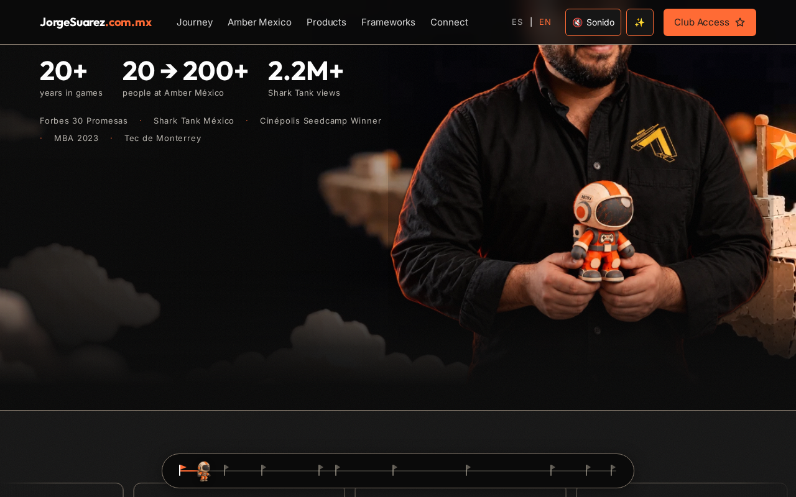

[Español](README.md) | [English](README.en.md)

<picture><source media="(max-width: 600px)" srcset="docs/media/cover-es-mobile.png"></picture>

# jorgesuarez.com.mx

**Conoce el recorrido y encuentra el proyecto que te interesa.** [Abre el sitio](https://jorgesuarez.com.mx/) y usa la navegación para ir a historia, proyectos o contacto. No necesitas instalar nada.

## ¿Qué es?
El sitio personal de Jorge Suárez: presenta su recorrido en videojuegos, iniciativas, recursos y vías de contacto. Es una entrada pública a contenidos y enlaces, no una prueba de que todos los servicios externos estén disponibles.

## ¿Para quién?
Para personas interesadas en videojuegos, emprendimiento y los proyectos públicos de Jorge; también para quienes quieren encontrar una forma de contacto.

## ¿Por qué existe?
Para reunir historia, proyectos y aprendizajes en un lugar. Puedes conocer el trabajo de Jorge en videojuegos y seguir los enlaces de la iniciativa que te interese.

## ¿Cómo lo uso?
1. [Visita la página](https://jorgesuarez.com.mx/).
2. Usa **ES / EN** para elegir idioma. En la captura pública los rótulos de navegación incluyen Journey, Amber Mexico, Products, Frameworks y Connect; algunos rótulos pueden mantenerse en inglés.
3. Ve a **Products** para explorar proyectos o **Connect** para encontrar contacto. Revisa las condiciones del destino antes de compartir datos o pagar.

Amber y las demás empresas conservan su identidad: la marca personal del builder no sustituye sus brandkits ni implica autoría o propiedad sobre sus productos.

## ¿Cuándo conviene y cuándo no?
Úsalo para conocer el recorrido, explorar enlaces y decidir qué consultar después. No lo tomes como un panel de clientes, un contrato, una plataforma de aprendizaje ya demostrada ni un comprobante de disponibilidad de todas las iniciativas.

## ¿Dónde lo encuentro?
[Sitio público](https://jorgesuarez.com.mx/) · [Perfil de proyectos](https://github.com/jorgefsb) · [Brandkit oficial](https://brandkit.jorgesuarez.com.mx/).

## Antes de seguir
- **Disponibilidad:** página pública verificada con HTTP 200 en Chromium el 22 de octubre de 2026. Esto no demuestra qué revisión del repositorio está desplegada.
- **Requisitos y ayuda técnica:** navegador moderno y conexión. Leer no requiere developer; cambiar o publicar el sitio sí requiere revisión técnica. No se garantiza rendimiento universal en móviles o GPU.
- **Costos y licencia:** consultar la página no exige pago; ofertas enlazadas pueden tener sus propios costos. `package.json` declara `UNLICENSED`; ver el código no otorga permiso de reutilización. Marca y fotografías no son MIT.
- **Privacidad:** leer abre conexiones con el sitio y sus recursos; los destinos externos tienen políticas propias. No hemos auditado cookies, almacenamiento ni todos los proveedores. La evidencia no envía formularios ni datos personales.
- **Límites:** se verificó navegación pública y desplazamiento, no acceso al club, pagos, formularios ni sistemas privados. Las capturas documentan el sitio tal como se observó, no funcionalidad añadida por esta documentación.
- **Ayuda:** [correo público de Jorge](mailto:jorgefsb@gmail.com) o [issues del repositorio](https://github.com/jorgefsb/jorgesuarez.com.mx/issues), sin secretos ni datos de clientes.

## Recorrido real

[Ver el video real](docs/media/walkthrough.mp4) · [Subtítulos y transcripción ES](docs/WALKTHROUGH.md) · [English captions](docs/WALKTHROUGH.en.md). Grabación de la página pública, sin envíos ni acceso a cuentas.

## Ruta técnica separada
[Notas para mantener este repositorio](docs/TECHNICAL.md) · [Guía documental](docs/REPOSITORY-DOCUMENTATION.md) · [Aviso de medios](docs/ASSET-NOTICE.md).

El README anterior atribuye v2 a un repositorio fuente privado y menciona GitHub Pages detrás de Cloudflare, pero también conserva referencias anteriores a Vercel. **No se ha verificado el vínculo entre este checkout, el build servido y el proveedor actual.** No uses esas notas como instrucciones de despliegue o rollback. Los registros históricos permanecen intactos.
